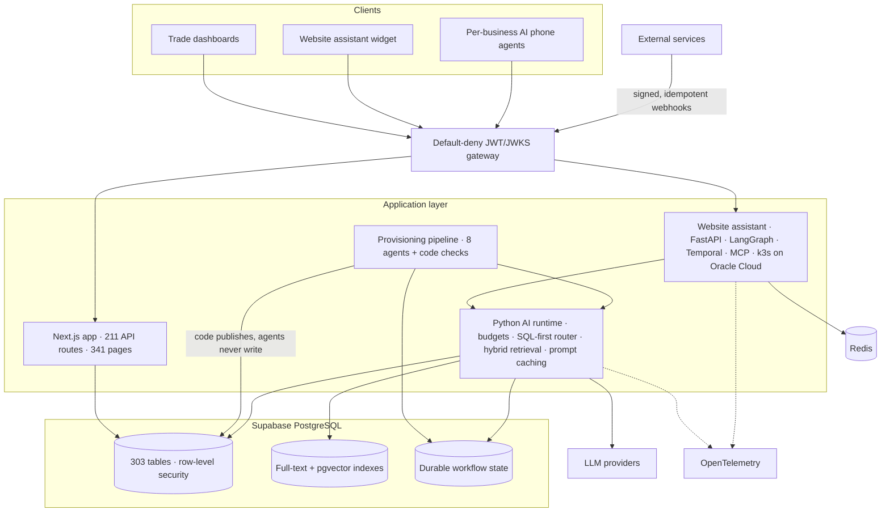
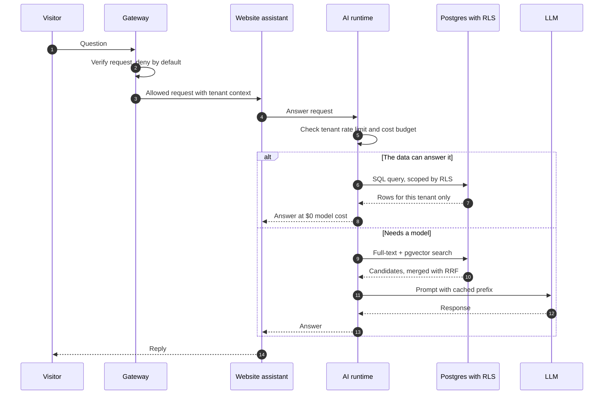
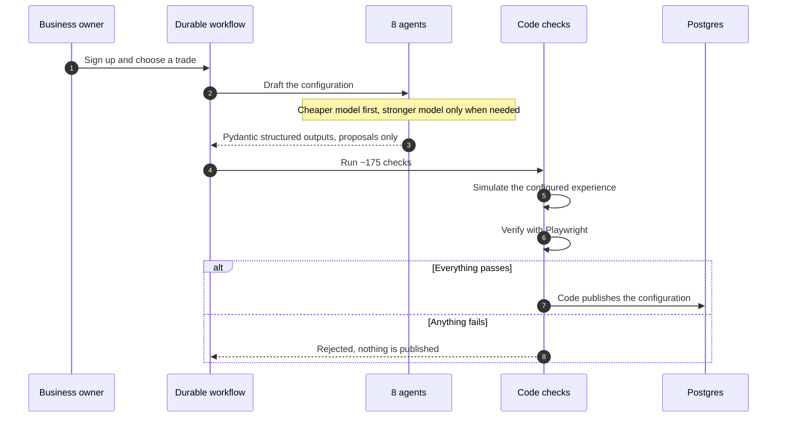
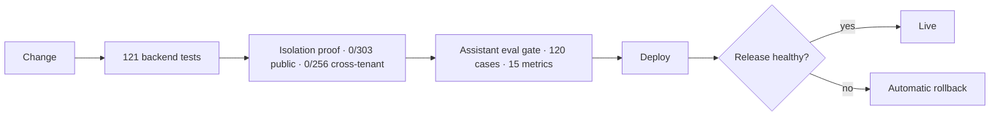

<h1 align="center">CreAIve Labs · System Design</h1>

  <b>A multi-tenant AI platform for local service businesses, designed, built, and operated by one engineer.</b> 
  <a href="https://creaivelabs.com">creaivelabs.com</a> · <a href="./README.md">Back to profile</a>

---

## The 60-second version

**The problem.** A dog groomer, a landscaper, and a cleaning company each need different software, an assistant that knows their business, and a phone agent that answers like them. One platform has to serve all of them at once without ever mixing their data, letting a model's mistake reach production, or letting AI costs run away.

**The rule behind every decision:** **AI proposes, code decides.** Models draft, rank, and answer. Deterministic code validates, isolates, budgets, and publishes.

**The proof, checked automatically on every release:**

| Claim | Evidence |
| --- | --- |
| No business can read another business's data | CI proves **0 of 303 tables publicly readable** and **0 of 256 leaking across tenants** |
| AI can't corrupt production data | Agents have **no write path** to the database. Code runs **~175 checks**, a simulation, and Playwright verification before anything publishes |
| Assistant quality can't silently regress | Every release must pass a **120-case / 15-metric eval gate** |
| Costs stay bounded | Data questions answered by **SQL at $0**. Per-tenant **token and cost budgets** enforced before any model call. Prompt caching cut research cost **$2.41 → $1.16** |
| A bad release doesn't stay live | **121 backend tests** gate every release, with **automatic rollback** |

## Contents

1. [Problem and constraints](#1-problem-and-constraints)
2. [Requirements](#2-requirements)
3. [Scale snapshot](#3-scale-snapshot)
4. [Design principles](#4-design-principles)
5. [Architecture overview](#5-architecture-overview)
6. [Component deep dives](#6-component-deep-dives)
7. [Request lifecycles](#7-request-lifecycles)
8. [Security model](#8-security-model)
9. [Failure modes and how the system handles them](#9-failure-modes-and-how-the-system-handles-them)
10. [Quality and evaluation](#10-quality-and-evaluation)
11. [Cost engineering](#11-cost-engineering)
12. [Observability](#12-observability)
13. [Delivery and release safety](#13-delivery-and-release-safety)
14. [Trade-offs I accepted](#14-trade-offs-i-accepted)
15. [The 20 steps, end to end](#15-the-20-steps-end-to-end)
16. [Tech stack by layer](#16-tech-stack-by-layer)
17. [Ask me about](#17-ask-me-about)

---

## 1. Problem and constraints

Local service businesses don't need a generic chatbot. A groomer needs bookings and reminders. A landscaper needs estimates. Each needs an assistant and a phone agent that answer from **their** data, in **their** voice.

Serving many of them from one platform creates four hard problems:

- **Isolation.** Many businesses share one database. A single missed filter in one query could expose one business's customers to another. That's not a bug you get to make once.
- **Trust in AI.** Models are useful for drafting and answering, but they are sometimes confidently wrong. A wrong answer in a chat is bad. A wrong value written into a live business configuration is worse.
- **Cost.** Every model call costs money. Without limits, one busy or misbehaving tenant can burn the budget for everyone.
- **One engineer.** There's no team to review every change or catch every mistake. Anything that matters has to be checked by the system itself, automatically, on every release.

## 2. Requirements

**Functional**

| # | Requirement |
| --- | --- |
| F1 | Onboard a new business and generate its configuration for its trade |
| F2 | Give each trade a dashboard built for how that trade works (15 today) |
| F3 | Answer website visitors' questions from the business's own data |
| F4 | Run a per-business AI phone agent |
| F5 | Accept events from external services safely |

**Non-functional, and how each is enforced**

| Quality | Target | How it's enforced |
| --- | --- | --- |
| Tenant isolation | Zero cross-tenant reads | PostgreSQL row-level security, proven in CI on every release |
| AI safety | No unvalidated AI output reaches production data | Agents propose only. Code validates and publishes |
| Cost control | Bounded spend per tenant, $0 when a model isn't needed | Budgets before calls, SQL-first routing, prompt caching, tiered models |
| Answer quality | No silent regressions | 120-case / 15-metric eval gate |
| Durability | Long-running work survives crashes | Durable Postgres workflow engine, Temporal for the assistant |
| Release safety | A bad deploy is reversed without a human | CI gates plus automatic rollback |
| Debuggability | Any request can be followed end to end | OpenTelemetry tracing |

## 3. Scale snapshot

| | |
| --- | --- |
| API routes | **211** |
| Pages | **341** |
| Trade dashboards | **15** |
| Database tables | **303** |
| Provisioning agents | **8** |
| Provisioning checks | **~175** |
| Backend tests gating release | **121** |
| Assistant eval gate | **120 cases, 15 metrics** |
| Engineers | **1** |

## 4. Design principles

These are invariants. Each one is enforced in a specific place, not just intended.

| Principle | What it means | Enforced by |
| --- | --- | --- |
| **AI proposes, code decides** | Model output is a proposal, never a write | Agents have no database write path. Pydantic schemas, ~175 checks, simulation, Playwright |
| **Deny by default** | Anything not explicitly allowed is rejected | JWT/JWKS gateway |
| **Isolation lives in the database** | Tenant safety can't depend on every query remembering a filter | PostgreSQL row-level security on every tenant table |
| **Data before models** | If SQL can answer, no model is called | SQL-first routing in the AI runtime |
| **Budgets before calls** | Spend is checked before it happens, not discovered after | Tenant-scoped rate and token/cost limits in the runtime |
| **Releases prove themselves** | Safety claims are tested, not assumed | CI isolation proof, 121 tests, eval gate, automatic rollback |

## 5. Architecture overview

**How to read it.** Every request enters through one default-deny gateway. Every model call, from any part of the platform, goes through one Python AI runtime, so budgets, routing, retrieval, and caching are enforced in a single place. All tenant data lives in PostgreSQL, where row-level security applies no matter which service is asking.

## 6. Component deep dives

### 6.1 Web app and trade dashboards

- **Next.js** on **Supabase PostgreSQL**, with **211 API routes** and **341 pages**.
- **15 trade dashboards.** Each trade gets a dashboard built for how it works, instead of one generic screen with every feature switched on.

### 6.2 Default-deny gateway

- Every request is checked with **JWT/JWKS** before it reaches a service.
- **Default-deny:** a new route is closed until it's explicitly opened. Forgetting to protect something fails safe.

### 6.3 Data layer and tenant isolation

- **One PostgreSQL database, many tenants.** Each tenant-owned row carries its tenant ID.
- **Row-level security (RLS)** makes PostgreSQL itself refuse rows from other tenants. If application code has a bug and forgets a filter, the database still says no.
- **Proven, not assumed.** CI checks that **0 of 303 tables are publicly readable** and that **0 of 256 tables leak across tenants**. If a new table ships without a correct policy, the release fails.

### 6.4 Python AI runtime

The single path for **every** model call in the platform.

- **Tenant-scoped gateway.** Rate limits and token/cost budgets are checked per tenant **before** a call is made.
- **SQL-first answers.** Questions that the data can answer (hours, services, prices, availability) are answered with SQL, at **$0** model cost and with no risk of the model inventing a number.
- **Hybrid retrieval.** When a question needs language understanding, the runtime searches with **PostgreSQL full-text search** (good at exact names and terms) and **pgvector** (good at meaning), then merges both rankings with **Reciprocal Rank Fusion (RRF)**.
- **Prompt caching.** Stable prompt prefixes are cached, which cut measured research cost from **$2.41 to $1.16**.
- **Durable Postgres workflow engine.** Multi-step work keeps its state in PostgreSQL, so a crash resumes from the last completed step instead of starting over.

### 6.5 Provisioning pipeline

This is where **"AI proposes, code decides"** matters most, because its output becomes a live business.

1. A durable workflow starts for the new business.
2. **Eight agents** draft the business's configuration.
3. Each agent returns a **Pydantic structured output**. Output that doesn't match the schema is rejected.
4. **Tiered model escalation:** work starts on a cheaper model and moves to a stronger one only when needed.
5. Agents **never write to the database**. Their output is a proposal.
6. Code runs **~175 deterministic checks** on the proposal.
7. The configured experience is **simulated**.
8. **Playwright** verifies what a real visitor would see.
9. Only then does **code** publish the configuration.

### 6.6 Website assistant

- **FastAPI** service, with **LangGraph** orchestrating the assistant's steps, **Temporal** for durable execution, **MCP** for tool access, **Redis**, and **OpenTelemetry** tracing.
- Runs on **k3s Kubernetes on Oracle Cloud**.
- Model calls go through the shared AI runtime, so the assistant inherits budgets, SQL-first routing, hybrid retrieval, and caching.
- Every release must pass the **120-case / 15-metric eval gate**.

### 6.7 Per-business AI phone agents

- Each business gets its own phone agent, configured by the provisioning pipeline and scoped to that business's data.

### 6.8 Webhooks

- Inbound events are **signed**: a request that can't prove where it came from is rejected.
- Handling is **idempotent**: if the same event arrives twice, the second delivery changes nothing.

## 7. Request lifecycles

### 7.1 A website visitor asks a question

### 7.2 A new business is provisioned

## 8. Security model

| Threat | Control | How I know it works |
| --- | --- | --- |
| One business reads another's data | PostgreSQL row-level security | CI: **0 of 256** tables leak across tenants |
| Data exposed to the public | RLS policies on every table | CI: **0 of 303** tables publicly readable |
| Unauthenticated or unknown request | Default-deny JWT/JWKS gateway | New routes are closed until opened |
| Forged webhook | Signature verification | Unsigned or mis-signed events are rejected |
| Replayed or duplicate webhook | Idempotent handling | Repeat deliveries change nothing |
| Model writes bad data | No AI write path, code validates | ~175 checks, simulation, Playwright before publish |
| Cost abuse by one tenant | Per-tenant rate and token/cost budgets | Enforced before the call, not after |

## 9. Failure modes and how the system handles them

| What goes wrong | What happens |
| --- | --- |
| Model returns output in the wrong shape | Pydantic rejects it. Tiered escalation can move the work to a stronger model |
| Model returns a valid-looking but wrong configuration | It's still only a proposal. ~175 checks, simulation, and Playwright stand between it and production |
| Worker crashes halfway through provisioning | The durable workflow resumes from the last completed step |
| A tenant's usage spikes | Rate and cost budgets stop the spend for that tenant only |
| Application code forgets a tenant filter | RLS refuses the rows anyway |
| Same webhook arrives twice | The second delivery is a no-op |
| A change makes the assistant worse | The 120-case eval gate blocks the release |
| A bad release reaches production | Automatic rollback |
| The eval gate itself becomes flaky | Treated as a bug in the system, traced to root cause (see 10.2) |

## 10. Quality and evaluation

### 10.1 The eval gate

The website assistant ships only if it passes **120 test cases scored across 15 metrics**. The gate runs on every release, so quality is a property the pipeline checks, not something I remember to look at.

### 10.2 Case study: the gate that failed only sometimes

- **Symptom.** The eval gate failed intermittently on code that hadn't changed.
- **The tempting fixes.** Re-run until it's green, or lower the threshold. Both would have hidden a real problem.
- **What I did.** I traced the failing cases to **retrieval ranking**: the right content was available, but it wasn't ranked high enough consistently.
- **Result.** Recall on that evaluation went from **0.8 to 1.0**, and the gate became something I could trust again.

**Lesson:** a flaky test is a signal. An eval gate is only worth having if a red result always means something.

## 11. Cost engineering

Cost is designed in at four levels, cheapest first:

| Level | Technique | Effect |
| --- | --- | --- |
| 1. Don't call a model | SQL-first answers | **$0** for questions the data can answer |
| 2. Don't overspend when you do | Per-tenant token/cost budgets | Spend is capped before the call |
| 3. Use the smallest model that works | Tiered model escalation | Stronger models only when cheaper ones fall short |
| 4. Don't pay twice for the same prompt | Prompt caching | Research cost **$2.41 → $1.16** |

## 12. Observability

- **OpenTelemetry** traces requests through the gateway, the AI runtime, retrieval, and model calls.
- With one engineer, tracing is the team: when something is slow or wrong, the trace shows where.

## 13. Delivery and release safety

- Every safety claim in this document is checked in CI. If any check fails, nothing ships.
- The website assistant runs on **k3s Kubernetes on Oracle Cloud**.

## 14. Trade-offs I accepted

| Decision | What I gained | What it costs |
| --- | --- | --- |
| Isolation in the database (RLS), not only in app code | Safety survives application bugs | A policy for every table, and a CI proof to keep them honest |
| Agents can't write; code decides | A model mistake can't reach production | ~175 checks to write and maintain, and slower provisioning |
| SQL-first routing | $0 and exact answers for data questions | A routing layer that has to classify questions correctly |
| Hybrid retrieval with RRF instead of vectors alone | Exact terms *and* meaning both rank well | Two indexes to maintain |
| Eval gate on every release | Regressions are blocked | Slower releases, and the gate itself must be reliable (10.2) |
| Durable workflow engine on Postgres | Workflow state lives next to the data, no extra infrastructure | Features a dedicated engine would give for free have to be built |
| Temporal for the website assistant | Proven durable execution for the assistant's long-running work | A second orchestration system to operate alongside the Postgres engine |
| Self-run k3s on Oracle Cloud | Low cost and full control | I operate the cluster myself |
| Prompt caching | Research cost roughly halved | Prompts have to keep stable prefixes |

## 15. The 20 steps, end to end

**Provision: agents propose, code decides**

1. **Tenant created.** A business signs up and gets its own tenant ID; every row it owns carries that ID.
2. **Trade template chosen.** The business maps to one of **15 trade dashboards**.
3. **Durable workflow starts.** Provisioning runs on the Postgres-backed workflow engine, so a crash resumes instead of restarting.
4. **Eight agents draft.** An **8-agent pipeline** drafts the business's configuration.
5. **Structured outputs only.** Every agent returns a **Pydantic** schema; anything that doesn't fit is rejected.
6. **Tiered model escalation.** Cheaper model first, stronger model only when needed.
7. **No database writes from AI.** Agents return proposals with no path to write.
8. **Deterministic checks.** Code runs **~175 checks** against every proposal.
9. **Simulation.** The configured experience is exercised before any customer sees it.
10. **Browser verification, then publish.** **Playwright** checks the rendered result; only a passing configuration is published, by code.

**Serve: every request is isolated, budgeted, and cheap by default**

11. **Default-deny gateway.** Every request passes a **JWT/JWKS** gateway that rejects anything not explicitly allowed.
12. **Isolation in the database.** **Row-level security** scopes every query to its tenant.
13. **Budgets before models.** The **Python AI runtime** enforces per-tenant rate and token/cost limits before any model call.
14. **SQL first.** If the data can answer, SQL answers, at **$0** model cost.
15. **Hybrid retrieval.** Otherwise, full-text and **pgvector** results are merged with **RRF**.
16. **Model call with caching.** **Prompt caching** cut research cost from **$2.41 to $1.16**. The website assistant runs on **FastAPI, LangGraph, Temporal, Redis, and MCP**.
17. **Safe inbound events.** **Signed, idempotent webhooks**: forged events are rejected and repeats change nothing.
18. **Everything traced.** **OpenTelemetry** follows each request end to end.

**Ship: releases have to prove they're safe**

19. **CI gates.** **121 backend tests**, **0 of 303 tables public**, **0 of 256 leaking across tenants**, and the **120-case / 15-metric** eval gate.
20. **Deploy with a way back.** **k3s Kubernetes on Oracle Cloud** with **automatic rollback**.

## 16. Tech stack by layer

| Layer | Technology |
| --- | --- |
| Frontend and app | Next.js |
| Data | Supabase PostgreSQL · row-level security · pgvector · full-text search |
| AI runtime | Python · Pydantic · tiered models · hybrid retrieval with RRF · prompt caching · durable Postgres workflow engine |
| Website assistant | FastAPI · LangGraph · Temporal · Redis · MCP |
| Security | JWT/JWKS default-deny gateway · RLS · signed idempotent webhooks |
| Quality | 121 backend tests · ~175 provisioning checks · Playwright · 120-case / 15-metric eval gate |
| Observability | OpenTelemetry |
| Infrastructure | k3s Kubernetes on Oracle Cloud · CI/CD with automatic rollback |

## 17. Ask me about

Happy to go deeper on any of these in a conversation:

- How the CI isolation proof checks all 303 tables, and what it caught
- Why agents get no write path, and what the ~175 checks look for
- How SQL-first routing decides when a model isn't needed
- How the flaky eval gate was traced back to retrieval ranking
- Where the line sits between the Postgres workflow engine and Temporal
- What I'd change if the platform had to serve 100× more businesses

  <a href="https://www.linkedin.com/in/vkrnemilidinne/">LinkedIn</a> · <a href="mailto:hello@creaivelabs.com">hello@creaivelabs.com</a> · <a href="./README.md">Back to profile</a>

