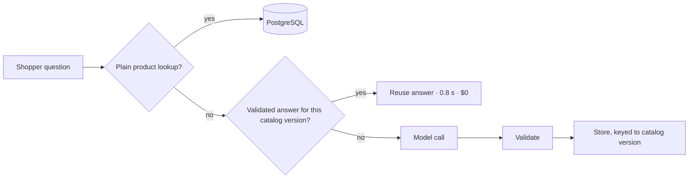
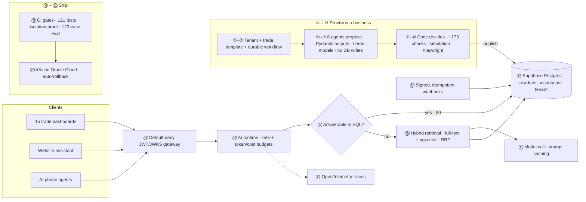

<h1 align="center">Varun Kumar Reddy Nemilidinne</h1>

  <b>Software & AI Engineer</b> · Backend · Streaming Data · Production AI · Virginia, USA

  
  
  
  
  

  <i>I build systems, then try to break them, then write down the numbers.</i>

---

I've shipped two live products on my own: **LiveKaart**, a grocery search and price-comparison app, and **CreAIve Labs**, an AI platform for local service businesses. I'm building a third, **HumanQA**, and learning CUDA C++ to see how data really moves between a CPU and a GPU.

Most portfolios list what someone built. This one lists **questions I asked and what the measurements said**, and every project links to a full design write-up.

## 🧪 Questions I answered with measurements

| The question | How I tested it | The answer |
| --- | --- | --- |
| Can a shopper get an accurate stock answer without waiting on a model? | Routed plain lookups to PostgreSQL and reused validated answers keyed to the catalog version | Median latency **3.7 s → 1.5 s**. Repeats in **0.8 s** at **$0** model cost |
| If a Kafka broker dies mid-payment run, does every transaction still reach the ledger? | Killed 1 of 3 brokers during a 2M-transaction run | Recovered in **8 s**. **0 lost, 0 duplicate** ledger rows |
| How fast can one laptop push a correct payments pipeline? | Java + Kafka Streams + Redis + PostgreSQL, idempotent end to end | **56,638 tx/s** sustained over 2M transactions |
| Can a model migrate legacy data without guessing? | Gated every record PASS / FAIL / UNKNOWN, writing only PASS | **2,000+ files → 7,500+ records** at **95%** field accuracy, **97%** automated |
| Why did my AI release gate fail only *sometimes*? | Traced a flaky eval to retrieval ranking | Recall on that eval **0.8 → 1.0** |
| Does prompt caching actually matter for research tasks? | Measured cost per research run before and after | **$2.41 → $1.16** per run |
| Can tenant isolation be *proven*, not just promised? | CI checks every table on every release | **0 of 303** tables publicly readable, **0 of 256** leaking across tenants |
| Which ad should a user see? | Simulated 13,500 impressions across ranking strategies | Bid × pCTR earned **+43% revenue per 1K** impressions, even as CTR fell 6.73% → 5.21% |
| Why was my first CUDA timing wrong? | Warmed up the GPU, averaged 100 launches with CUDA events | First number was inflated **17×**. Real: **0.043 ms**, **294 GB/s** |

## 🧭 How I build

Four rules run through my work, at employers and in everything I've shipped on my own.

| Rule | Where it shows up |
| --- | --- |
| **Nothing uncertain gets written.** | PASS / FAIL / UNKNOWN write gates at Index Systems · AI agents with no database write path at CreAIve Labs · schema-validated model output at Tekrubix · ledger committed before Kafka offsets |
| **Cheapest correct path first.** | SQL answers at $0 in CreAIve Labs and LiveKaart · answers reused by catalog version in LiveKaart · tiered models and prompt caching in CreAIve Labs |
| **Measure before believing.** | 60-query deploy gate in LiveKaart · 120-case eval gate in CreAIve Labs · 300+ query evaluation at Tekrubix · a 17× CUDA timing error caught and fixed |
| **Prove the failure case.** | A Kafka broker killed mid-run · tenant isolation proven in CI · a flaky gate traced to root cause · HumanQA tests what an agent *did*, not what it said |

## 📐 Design docs

Every project has a full write-up: the problem, the architecture, how it fails, and the trade-offs I accepted.

| Design doc | Read it for |
| --- | --- |
| [**CreAIve Labs**](./docs/creaivelabs.md) | Multi-tenant isolation proven in CI, AI agents that propose but never write, the 20-step lifecycle |
| [**LiveKaart**](./docs/livekaart.md) | A database-first AI gateway, and why answers are cached by catalog version instead of by time |
| [**Kafka payments pipeline**](./docs/kafka-payments-pipeline.md) | Exactly-once ledger results from at-least-once delivery, the broker-failure test, benchmark method |
| [**AI-assisted migration** · Index Systems](./docs/index-systems-ai-migration.md) | Three-state write gates that let a system say "I don't know" |
| [**Supply-chain pipelines and copilot** · Tekrubix](./docs/tekrubix-supply-chain.md) | Streaming data quality, and a copilot grounded in SQL with validated outputs |
| [**AdRank**](./docs/adrank.md) | Why the most-clicked ad isn't the best ad to show |
| [**HumanQA**](./docs/humanqa.md) | Testing what an AI agent actually did |
| [**CUDA lab notebook**](./docs/cuda-lab-notebook.md) | How a 17× timing error was found, and the bandwidth math |

## 🚀 Products I've shipped

### [LiveKaart](https://livekaart.com) · Grocery search and price comparison

A shopper asking *"Is toor dal in stock?"* needs the current catalog, not a model's guess. So the assistant asks the database first and only calls a model when the question actually needs one.

- **Speed:** median assistant latency **3.7 s → 1.5 s**; a repeated query took **0.8 s** from reuse vs **5.5 s** through the model.
- **Quality:** every deploy gated on **60 golden queries** scored with Precision, Recall, NDCG, and MRR.
- **Uptime:** **99.91%** across **2,177** probes, watched from a 21-tab observability console I built.
- **Scope:** shipped solo in **7 weeks / 268 commits**: web app, store and admin tools, and an Expo React Native app for iOS and Android.

📐 **[Read the full LiveKaart system design →](./docs/livekaart.md)**

### [CreAIve Labs](https://creaivelabs.com) · AI for local service businesses

A groomer answering a call and a landscaper writing an estimate need different tools. CreAIve Labs gives each trade its own dashboard and AI phone agent, on one shared runtime that keeps every business's data separate.

- **Setup without blind trust:** an **8-agent pipeline** drafts each business's configuration, but agents never write to the database. Code runs **~175 checks**, simulations, and Playwright verification before anything publishes.
- **Release gate:** the website assistant must pass **120 cases across 15 metrics** before it ships.
- **Cost:** plain business questions are answered with SQL at **$0**; hybrid full-text + pgvector retrieval handles the rest.
- **Security:** default-deny JWT/JWKS gateway, PostgreSQL row-level security, signed idempotent webhooks, and **121 backend tests** with automatic rollback.
- **Scale:** **15 trade dashboards** and **211 API routes**, built and run as the sole engineer.

#### 🏗️ System design · 20 steps from sign-up to safe release

One rule runs through the whole design: **AI proposes, code decides.** Models draft, rank, and answer. Deterministic code validates, isolates, and publishes.

<b>Read all 20 steps</b>

 

**Provision: agents propose, code decides**

1. **Tenant created.** A business signs up and gets its own tenant ID; every row it will ever own carries that ID.
2. **Trade template chosen.** The business maps to one of **15 trade dashboards**, so a groomer and a landscaper start from different tools.
3. **Durable workflow starts.** Provisioning runs on a Postgres-backed workflow engine, so a crash resumes from the last finished step instead of starting over.
4. **Eight agents draft.** An **8-agent pipeline** drafts the business's configuration.
5. **Structured outputs only.** Every agent returns a **Pydantic** schema; anything that doesn't fit the shape is rejected, not repaired by guesswork.
6. **Tiered model escalation.** Work starts on a cheaper model and escalates to a stronger one only when it fails.
7. **No database writes from AI.** Agents return proposals. They have no path to write to the database.
8. **Deterministic checks.** Code runs **~175 checks** against every proposal.
9. **Simulation.** The configured assistant is exercised before any customer sees it.
10. **Browser verification, then publish.** **Playwright** checks the rendered experience; only a passing configuration is published.

**Serve: every request is isolated, budgeted, and cheap by default**

11. **Default-deny gateway.** Every call from dashboards, the website assistant, or phone agents passes a **JWT/JWKS** gateway that rejects anything not explicitly allowed.
12. **Isolation in the database itself.** **PostgreSQL row-level security** scopes every query to its tenant, so a bug in app code still can't read another business's data.
13. **Budgets before models.** The **Python AI runtime** enforces per-tenant rate limits and token/cost budgets before any model is called.
14. **SQL first.** If a question can be answered from data, SQL answers it, at **$0** model cost.
15. **Hybrid retrieval.** Otherwise, full-text search and **pgvector** results are fused with **Reciprocal Rank Fusion (RRF)**.
16. **Model call with caching.** The model gets only what it needs; **prompt caching** cut research cost from **$2.41 to $1.16**. The website assistant runs on **FastAPI, LangGraph, Temporal, Redis, and MCP**.
17. **Safe inbound events.** External events arrive through **signed, idempotent webhooks**, so a forged or repeated event changes nothing.
18. **Everything traced.** **OpenTelemetry** follows each request through gateway, runtime, retrieval, and model.

**Ship: releases have to prove they're safe**

19. **CI gates.** A release must pass **121 backend tests**, prove **0 of 303 tables publicly readable** and **0 of 256 leaking across tenants**, and clear the assistant's **120-case / 15-metric eval gate**.
20. **Deploy with a way back.** Passing builds deploy to **k3s Kubernetes on Oracle Cloud** with **automatic rollback** if the release goes bad.

📐 **[Read the full CreAIve Labs system design →](./docs/creaivelabs.md)**

## 🛠️ Engineering projects

| Project | What it proves | Design |
| --- | --- | --- |
| [**Kafka payments benchmark**](https://github.com/creAIveLabs-Test/kafka-payments-pipeline-benchmark) | Java pipeline with idempotent producers, Kafka Streams (RocksDB state), cache-aside enrichment, and a ledger committed *before* offsets. **56,638 tx/s**, p50 **92 ms** at a fixed 20K tx/s, all **24.4M** IBM TabFormer rows replayed, and a broker kill survived with zero lost or duplicate rows. | [Read →](./docs/kafka-payments-pipeline.md) |
| [**AdRank**](https://github.com/creAIveLabs-Test/adrank) | Ad-ranking simulator showing why the "best click rate" ad isn't the best ad: bid × predicted CTR earned **43% more revenue per 1K impressions**. | [Read →](./docs/adrank.md) |
| [**HumanQA**](https://humanqa.ai) | TypeScript SDK that tests what an AI agent *actually did*, not what it said. In the refund demo, deleting the customer record fails the test with exit code `1` and links the failure to the recorded action. | [Read →](./docs/humanqa.md) |
| [**Weather SDK**](https://github.com/creAIveLabs-Test/Weather-SDK) | A public Python SDK. | |

## 🔬 Lab notebook · GPU memory and CUDA C++

Running small kernels on an **NVIDIA RTX 2070 Max-Q** to learn where execution time really goes.

- [x] Vector addition on **1,048,576 floats**: fixed a **17×** timing error, measured **0.043 ms** per launch and **294 GB/s** effective bandwidth
- [ ] Pinned host memory vs pageable transfers
- [ ] Overlapping transfers and compute with CUDA streams
- [ ] Tiled matrix multiplication vs cuBLAS

📐 **[Read the lab notebook, with the bandwidth math →](./docs/cuda-lab-notebook.md)**

## 💼 Experience

**Index Systems Inc.** · Software Development Engineer, AI · *Jun 2026 – present*  
Backend for a platform spanning **8 business modules** and **20+ REST endpoints**, shipped with Docker, Kubernetes (AKS), Helm, and CI/CD. Built an AI-assisted migration that turned **2,000+ legacy files into 7,500+ PostgreSQL records** at **95% field-level accuracy** and **97% automation**, with PASS / FAIL / UNKNOWN write gates so nothing uncertain lands in the database. Mentor an engineering intern.  
📐 [Case study: the AI-assisted migration →](./docs/index-systems-ai-migration.md)

**Tekrubix** · AI Engineer, Supply Chain Systems · *Feb 2025 – May 2026*  
Kafka and PySpark pipelines on Databricks and Delta Lake processing **~1M records/day** for inventory, shipment, and delivery visibility across **60+ stores**. Built a FastAPI supply-chain copilot on Claude 3.5 with SQL retrieval and schema-validated structured outputs, evaluated on **300+ queries** at **p95 under 4 s**.  
📐 [Case study: pipelines and copilot →](./docs/tekrubix-supply-chain.md)

## 🧰 Toolbox

| | |
| --- | --- |
| **Backend & apps** | Python · Java · TypeScript · SQL · FastAPI · Pydantic · Next.js · React · React Native |
| **Data & streaming** | Kafka · Kafka Streams · PySpark · Databricks · Delta Lake · PostgreSQL · Redis · Temporal |
| **AI systems** | Claude · OpenAI APIs · LangGraph · RAG · pgvector · tool calling · MCP · golden-set evals · MLflow |
| **Delivery & quality** | Docker · Kubernetes · Helm · GitHub Actions · OpenTelemetry · pytest · Playwright · PostgreSQL RLS |

## 🎓 Education

**M.S., Computer Science and Engineering** · George Mason University, Fairfax, VA · 2024  
**B.Tech.** · Sri Venkateswara University, Tirupati, India · 2022

---

  I'm looking for <b>software engineering and applied AI roles</b> where I can build the product, measure how it behaves, and improve the systems behind it.  
  <a href="https://www.linkedin.com/in/vkrnemilidinne/">LinkedIn</a> · <a href="mailto:hello@creaivelabs.com">hello@creaivelabs.com</a>

